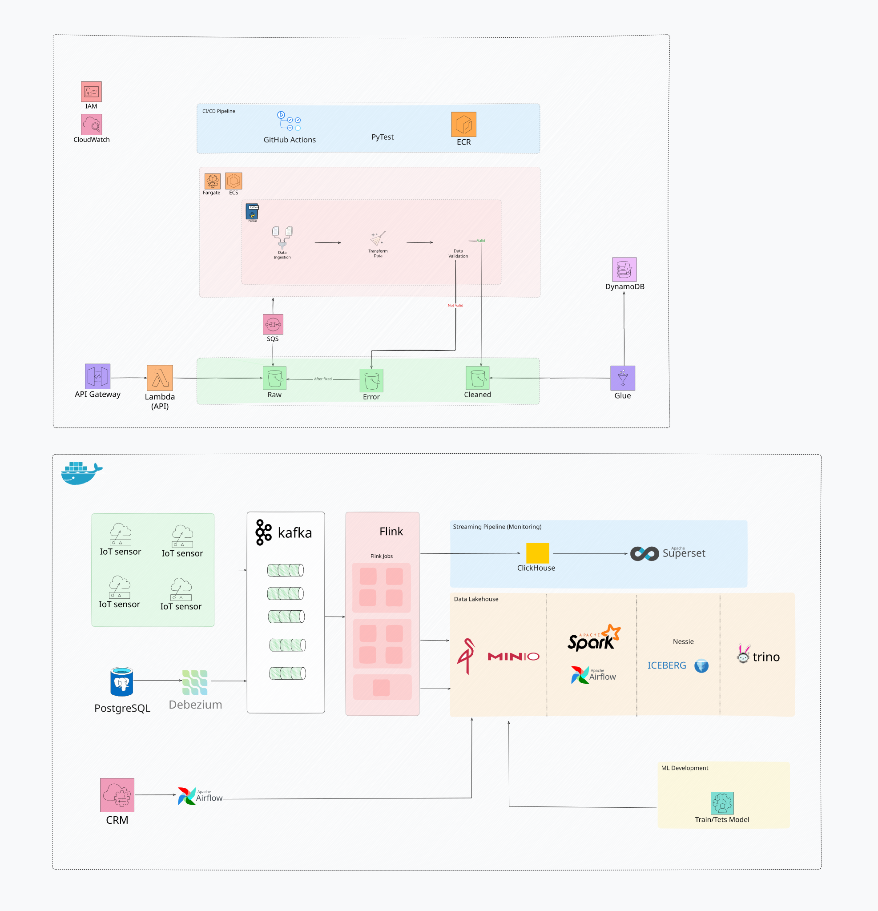

# Smart Factory Data Pipeline

## **Overview**

This project demonstrates the development of a modern, end-to-end data pipeline using a **Data Lakehouse** architecture, with a specific case study focused on **Chinese automotive manufacturers establishing factories in Indonesia**. As Indonesia targets over 2 million electric cars on the road by 2030, Chinese brands like Wuling, BYD, and Chery are setting up local production. To compete effectively in the price-sensitive Indonesian market and build long-term consumer trust, maintaining high quality control and consistent production is crucial. This project is designed to tackle the core operational challenges these new factories will face, while also closing the loop on vehicle quality through after-sales data.

> **Note:** This project utilizes **synthetically generated data** to simulate these real-world scenarios. This approach allows the project to demonstrate robust **data engineering capabilities**—handling high velocity, volume, and variety—without relying on proprietary datasets.

### Business Challenges
Automotive manufacturers face three primary challenges:
1.  **Unexpected Machine Failures (Production):** Although production machinery is equipped with IoT sensors, the data is typically used only for monitoring rather than for predictive purposes. As a result, potential issues often go unnoticed until they cause costly breakdowns.
2.  **Siloed Data Systems (Operations):** Supply chain data is stored in legacy databases, while sales and customer demand insights reside in separate CRM systems. Without seamless integration, aligning production schedules with market demand is difficult.
3.  **Fragmented Service History (After-Sales):** As vehicles enter the market, service records from dispersed dealerships are often decentralized and semi-structured. This disconnect prevents manufacturers from effectively tracking real-world vehicle performance and identifying recurring quality issues post-production.

### Data Engineering Solution
To address these challenges, this project proposes a **Hybrid Data Platform**:
*   **On-Premise/Cloud Data Lakehouse:** Centralizes factory IoT, Supply Chain, and CRM data using Apache Iceberg and MinIO for deep operational analytics and predictive maintenance.
*   **Serverless Cloud Pipeline (AWS):** Aggregates and processes distributed service records from dealerships using a scalable, event-driven architecture (Lambda, Fargate, Glue).

This dual approach unifies the entire vehicle lifecycle—from the factory floor to the dealership service bay.


## **Project Goals**

* **Build a Centralized Data Platform:** Integrate data from siloed sources (IoT, PostgreSQL, CRM) into a reliable single source of truth.
* **Implement Predictive Maintenance:** Transform IoT sensor data from simple monitoring feeds into predictive insights to reduce machine downtime.
* **Improve Forecasting Accuracy:** Align sales and supply chain data to enhance the accuracy of market demand forecasting and production planning.
* **Analyze Real-World Performance:** Capture and process service records from dealerships to close the feedback loop between manufacturing quality and after-sales reliability.
* **Design a Scalable Architecture:** Establish a modern and scalable data foundation using Data Lakehouse technology with Apache Iceberg to support future business growth.


## **Solution**

To address the business challenges across the vehicle lifecycle, this project employs a **Hybrid Data Architecture** consisting of two distinct but complementary pipelines:



### **1. Smart Factory Data Lakehouse (Bottom Architecture)**
*Focus: High-volume sensor data, production efficiency, and predictive maintenance.*

**Workflow:**
1.  **Data Sources (Simulated):** A custom **Data Generator** simulates realistic high-volume data streams from **IoT** sensors, **PostgreSQL** (Supply Chain), and **CRM** (Sales).
2.  **Ingestion:**
    *   **Apache Kafka** buffers high-velocity streaming IoT data.
    *   **Apache Airflow** orchestrates batch ingestion from CRM and database sources.
3.  **Processing:** **Spark Streaming** and **Flink** process real-time streams, while **Apache Spark** handles heavy batch transformations.
4.  **Storage (Lakehouse):**
    *   **MinIO** provides S3-compatible object storage.
    *   **Apache Iceberg** enables ACID transactions and time-travel on the data lake.
    *   **Nessie** acts as the catalog, providing Git-like version control for data.
5.  **Analytics & ML:**
    *   **Trino** enables fast SQL analytics on the Lakehouse.
    *   **Scikit-learn** models use this data to predict machine failures.
6.  **Visualization:** **Apache Superset** provides dashboards for OEE and production monitoring.

---

### **2. Dealership Service Pipeline (Upper Architecture)**
*Focus: Semi-structured, bursty service records and real-world performance tracking.*

**Workflow:**
1.  **Ingest:** Dealerships push semi-structured JSON service records to a secure **API Gateway**.
2.  **Buffer:** **SQS** queues incoming data to decouple ingestion from processing, handling traffic spikes without data loss.
3.  **Process:** **ECS Fargate** (Serverless Containers) scales up on-demand to validate and clean data using **Pandas/Pandera**.
4.  **Store:** Validated data is loaded into **DynamoDB** for operational access and **S3** for long-term analytics.

👉 **[For full implementation details of the AWS Pipeline, click here](./aws/README.md)**

---

## **Key Features**

**Factory Lakehouse (Core):**
*   **Data Lakehouse with Apache Iceberg:** Combines data warehouse reliability (ACID) with data lake flexibility.
*   **"Git-like" Data Management:** Uses Nessie for branching, tagging, and merging data versions.
*   **Unified Batch & Stream:** seamless handling of both IoT streams and transactional business data.
*   **Predictive ML Lifecycle:** End-to-end integration of machine learning for maintenance prediction.

**Service Network (Cloud):**
*   **Serverless Architecture:** Utilizes AWS Lambda and Fargate for zero-maintenance infrastructure.
*   **Event-Driven Design:** Reacts instantly to incoming data using S3 Events and SQS.
*   **Cost-Efficient Scaling:** Automatically scales compute resources to zero during inactive periods.


## **Project Set Up**

### Prerequisites
* Docker Desktop

### Installation Steps

1.  Clone This Repository
    ```bash
    git clone https://github.com/ArkanNibrastama/carFactoryDataPipeline.git
    cd carFactoryDataPipeline
    ```

2. Set up credentials with your own key
    ```python
    # /airflow/dags/load_gsheet_data.py
    GSHEET_ID = "{YOUR_GSHEET_ID}"
    ```

2.  Run All Services
    ```bash
    docker-compose --profile default up -d
    ```

    Or run per section
    
    ```bash
    docker-compose --profile streamProcessing up -d
    ```
    ```bash
    docker-compose --profile cdc up -d 
    ```
    ```bash
    docker-compose --profile batchProcessing up -d 
    ```
    ```bash
    docker-compose --profile lakehouse up -d 
    ```

4.  Verify the Installation
    * Access the service UIs:
        * **MinIO Console:** http://localhost:9002
        * **Airflow UI:** http://localhost:8080
        * **Superset UI:** http://localhost:8088
        * **Nessie UI:** http://localhost:19120


## **Conclusion**

This project demonstrates how a modern Data Lakehouse architecture can effectively solve real-world challenges in the manufacturing industry. By integrating previously siloed data and leveraging it for predictive analytics, companies can significantly reduce operational costs, improve production efficiency, and make smarter, data-driven business decisions.
